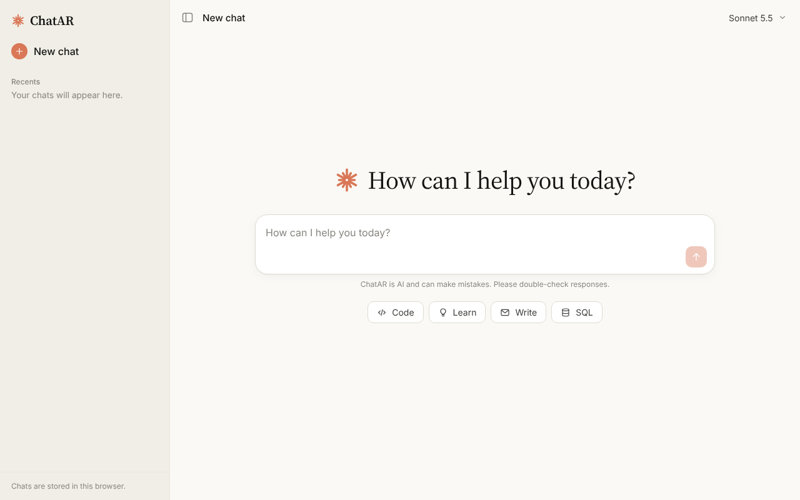
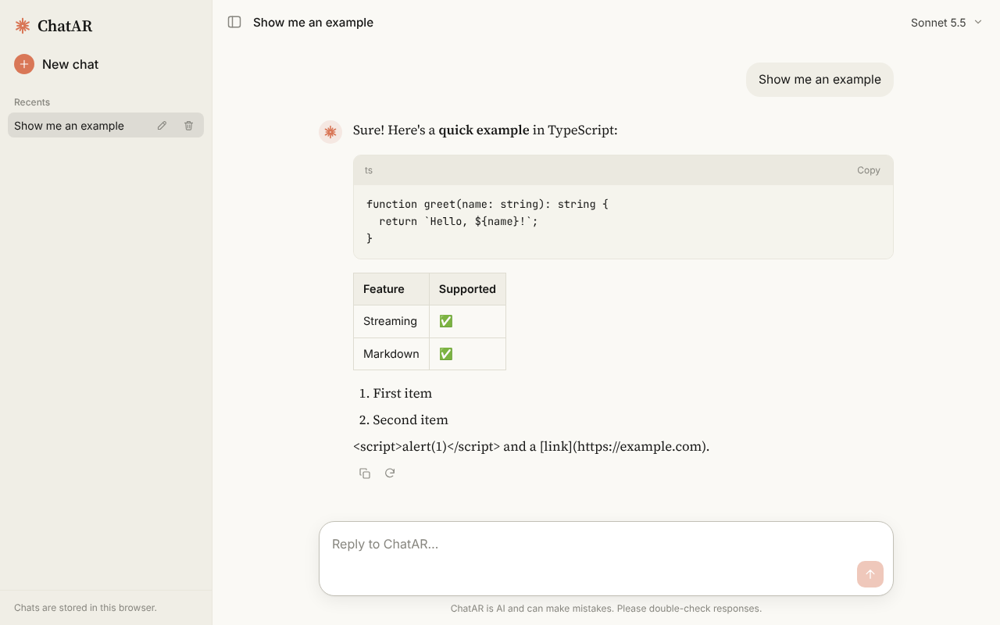
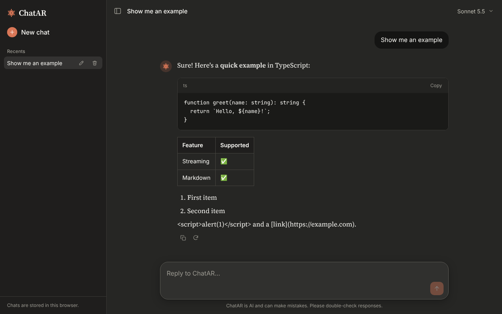
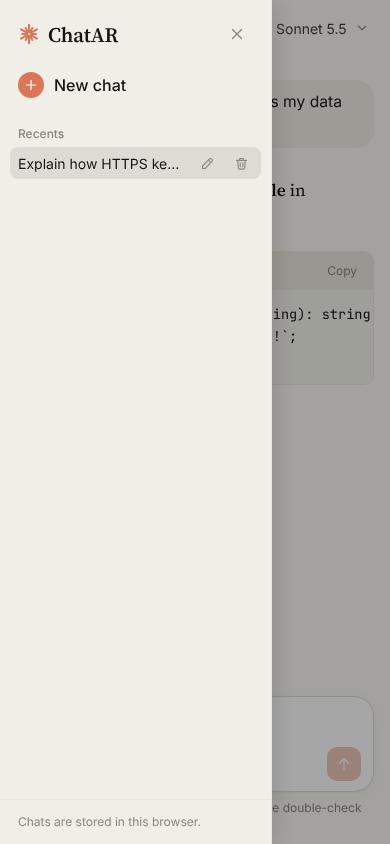

# ChatAR

A Claude.ai-style chat application: an **Angular** frontend talks to a **.NET 10** Web API, which calls the **Anthropic Claude API**.

```
Angular (http://localhost:4200)  ──►  ChatApi .NET 10 (http://localhost:5080/api)  ──►  https://api.anthropic.com/v1/messages
          no API key                          holds the API key
```

The browser never sees the Anthropic API key. It only calls the ChatAR API.

## Screenshots

| Start screen | Chat (light) |
|---|---|
|  |  |

| Chat (dark mode) | Mobile drawer |
|---|---|
|  |  |

## Features

- Streaming answers that appear word by word (`fetch` + `ReadableStream` in the browser, SSE parsing on the server)
- Animated typing indicator until the first token arrives, plus a Stop button (`AbortController`) that also cancels the upstream Claude call
- Regenerate the last answer, or retry it after an error
- Markdown rendering with `marked`: code blocks with a language label and a copy button, tables and lists. Raw HTML is escaped, and Angular's sanitizer stays on.
- Copy button on every answer
- Chats are saved in `localStorage`. Each chat is titled from its first message, and you can rename or delete it.
- Model selector (Sonnet 5.5, Opus 5.5, Haiku 5.5). The server checks the choice against an allow-list.
- Warm Claude-like design with automatic dark mode. The layout is responsive and the sidebar becomes a slide-over drawer on mobile.
- Backend: input validation, a limit of 20 requests per minute per IP, CORS restricted to the frontend origin, ProblemDetails errors, logging, and Claude status codes passed through to the client
- Unit and integration tests for both the backend and the frontend
- Docker and docker-compose files for running both apps

## Project structure

```
ChatAR/
├── backend/
│   ├── ChatAR.slnx
│   ├── Dockerfile
│   ├── ChatApi/                       .NET 10 minimal API
│   │   ├── Program.cs                 DI, CORS, rate limiting, exception handling
│   │   ├── Endpoints/ChatEndpoints.cs /api/health, /api/chat, /api/chat/stream
│   │   ├── Services/ClaudeClient.cs   HttpClient (IHttpClientFactory) → Messages API
│   │   ├── Services/ClaudeStreamParser.cs  SSE line → text
│   │   ├── Services/ChatRequestValidator.cs
│   │   ├── Infrastructure/GlobalExceptionHandler.cs
│   │   ├── Options/                   AnthropicOptions, ChatLimitsOptions
│   │   └── appsettings.json           (empty ApiKey, never commit a key)
│   └── ChatApi.Tests/                 xUnit tests
├── frontend/                          Angular 22, standalone components, signals, zoneless
│   ├── Dockerfile, nginx.conf
│   └── src/
│       ├── environments/environment.ts   ← the only place with the API URL
│       └── app/
│           ├── app.ts / app.html         shell: sidebar, header, thread, composer
│           ├── services/chat.service.ts  HTTP + streaming
│           ├── services/chat.store.ts    signal state + localStorage
│           ├── services/markdown.service.ts
│           └── components/  sidebar, composer, message, chat-thread, empty-state, icon
├── docs/screenshots/                 README images
├── docker-compose.yml
└── .env.example
```

## Prerequisites

| Tool | Version |
|---|---|
| .NET SDK | 10.0 |
| Node.js | 22.22.3+ or 24.15+ (required by Angular CLI 22) |
| npm | 10+ |
| An Anthropic API key | from https://console.anthropic.com |

## How the projects were created

These commands are listed for reference. The repository already contains their output, so you don't need to run them.

```bash
mkdir ChatAR && cd ChatAR

# Backend
mkdir backend && cd backend
dotnet new web   -n ChatApi       -o ChatApi
dotnet new xunit -n ChatApi.Tests -o ChatApi.Tests
dotnet new sln   -n ChatAR
dotnet sln add ChatApi/ChatApi.csproj ChatApi.Tests/ChatApi.Tests.csproj
dotnet add ChatApi.Tests reference ChatApi
dotnet add ChatApi.Tests package Microsoft.AspNetCore.Mvc.Testing --version 10.0.12
cd ..

# Frontend
npx @angular/cli@22 new frontend --style=scss --ssr=false --skip-git --defaults
cd frontend
npm install marked@18
```

## 1. Set the API key

Never put the key in `appsettings.json` or commit it. Use one of these options.

**Option A: dotnet user-secrets (recommended for development).** The key is stored outside the repo in your user profile.

```bash
cd backend/ChatApi
dotnet user-secrets set "Anthropic:ApiKey" "sk-ant-..."
dotnet user-secrets list          # verify
```

**Option B: environment variable**

```bash
# macOS / Linux
export Anthropic__ApiKey="sk-ant-..."      # or: export ANTHROPIC_API_KEY="sk-ant-..."

# Windows PowerShell
$env:Anthropic__ApiKey = "sk-ant-..."
```

If no key is configured, the API still starts and logs a warning. Chat requests then fail with a clear `503` error.

## 2. Run the backend

```bash
cd backend
dotnet restore
dotnet run --project ChatApi --launch-profile http
# → http://localhost:5080
curl http://localhost:5080/api/health
```

Test the endpoints from the command line:

```bash
curl -X POST http://localhost:5080/api/chat \
  -H "Content-Type: application/json" \
  -d '{"messages":[{"role":"user","content":"Say hello in 3 languages"}]}'

curl -N -X POST http://localhost:5080/api/chat/stream \
  -H "Content-Type: application/json" \
  -d '{"messages":[{"role":"user","content":"Write a haiku about C#"}]}'
```

## 3. Run the frontend

```bash
cd frontend
npm install
npm start            # ng serve → http://localhost:4200
```

Open http://localhost:4200. If the backend isn't running, a banner says so, and sending a message shows a friendly error.

## 4. Run the tests

```bash
# Backend: validator, SSE parser, Claude client (stubbed HTTP), endpoints (WebApplicationFactory)
cd backend && dotnet test

# Frontend: ChatService (mocked fetch/streams), ChatStore, ComposerComponent (Vitest)
cd frontend && npm test
```

## 5. Run with Docker (optional)

```bash
cp .env.example .env        # then put your key in .env (git-ignored)
docker compose up --build
# UI: http://localhost:4200   API: http://localhost:5080/api/health
```

## API

| Method | Path | Body | Response |
|---|---|---|---|
| GET | `/api/health` | – | `{ "status": "ok", "time": "..." }` |
| POST | `/api/chat` | `{ "messages": [...], "model"?: "claude-sonnet-5-5" }` | `{ "reply": "..." }` |
| POST | `/api/chat/stream` | same | `text/plain` chunks, flushed as they arrive |

Each message is `{ "role": "user" | "assistant", "content": "..." }`, and the last message must come from `user`.

Errors are returned as `application/problem+json`:

- `400`: validation failed, for example empty messages, too many messages, a message that is too long, or a model that isn't allowed
- `429`: the local rate limit or Anthropic's rate limit was hit
- `401`, `529` and other Anthropic errors keep their original status code
- `503`: no API key is configured
- `500`: an unexpected error (no internal details are returned)

## Configuration (`backend/ChatApi/appsettings.json`)

| Key | Default | Notes |
|---|---|---|
| `Anthropic:ApiKey` | `""` | Use user-secrets or an environment variable instead |
| `Anthropic:Model` | `claude-sonnet-5-5` | Default model |
| `Anthropic:AllowedModels` | Sonnet 5.5, Opus 5.5, Haiku 5.5 | Allow-list for the model selector (keep in sync with `environment.ts`) |
| `Anthropic:MaxTokens` | `16000` | Maximum length of an answer |
| `Anthropic:Effort` | `low` | `output_config.effort`. `low` suits chat. Raise it to `medium` or `high` for harder reasoning, at the cost of more tokens and latency. |
| `Anthropic:SystemPrompt` | ChatAR persona | Sent as `system` |
| `Anthropic:ServerSideFallbackModels` | Sonnet 5.5, Opus 5.5 | For these models the request sends `"fallbacks": "default"` with the `anthropic-beta: server-side-fallback-2026-07-01` header. If a safety classifier declines a request, Anthropic retries it on its recommended fallback model. Set it to `[]` to turn this off. |
| `ChatLimits:MaxMessages` | `50` | Maximum turns per request (the frontend sends at most the last 50) |
| `ChatLimits:MaxMessageLength` | `20000` | Characters per message |
| `ChatLimits:MaxTotalLength` | `200000` | Characters per request |
| `ChatLimits:RequestsPerMinute` | `20` | Per client IP |
| `Cors:AllowedOrigins` | `["http://localhost:4200"]` | Exact origins only |

The frontend API URL lives in `frontend/src/environments/environment.ts` (`apiBaseUrl`).

## Security notes

- The API key exists only on the server. It isn't stored in `appsettings.json`, the frontend, or git. `.gitignore` excludes `.env` files and local settings.
- Rendered Markdown goes through `[innerHTML]`, so Angular's sanitizer always runs. On top of that, raw HTML in model output is escaped, and links open with `rel="noopener noreferrer"`.
- The server checks message count and length and the chosen model, and applies rate limiting.
- CORS allows only the configured origin and only the `GET` and `POST` methods.
- Unexpected exceptions return a generic message. Details go to the server log only.

## Get the code

Clone this repository:

```bash
git clone https://github.com/AnilARR/ChatAR.git
cd ChatAR
```

To push your own changes:

```bash
git status                      # make sure no secrets, bin/obj or node_modules are listed
git add .
git commit -m "Describe your change"
git push origin main
```

If you accidentally commit a key, rotate it immediately in the Anthropic Console. Removing it from git history is not enough.

## Known limitations

- Chats live only in this browser's `localStorage`. They don't sync across devices, and very long histories can hit the roughly 5 MB storage quota.
- There is no authentication, so anyone who can reach the API can use your key, within the rate limit. Don't expose it publicly as-is.
- Rate limiting is in-memory and keyed by the client IP. Behind a reverse proxy, enable `ForwardedHeaders`, and use a distributed limiter if you run several instances.
- The whole conversation (the last 50 turns) is sent on every request, so long chats use more tokens. There is no summarisation or prompt caching yet.
- Errors that occur after streaming has started can't change the HTTP status, so they appear as an inline note in the answer.
- Code blocks aren't syntax-highlighted.
- Anthropic API calls aren't retried automatically. The user can press Retry.

## Suggested next steps

1. Add login (JWT) and store chats in SQL Server with EF Core, so history follows the user.
2. Upload files and images (sent to Claude as base64 `image` and `document` content blocks).
3. Add a settings panel for a custom system prompt or persona per chat.
4. Show token usage per conversation (read `usage` from `message_start` and `message_delta` events).
5. Add prompt caching (`cache_control`) on the system prompt and history to cut cost and latency on long chats.
6. Add syntax highlighting (for example highlight.js or Shiki) and LaTeX rendering.
7. Add end-to-end tests (Playwright), CI (GitHub Actions running `dotnet test` and `npm test`), and container image publishing.
